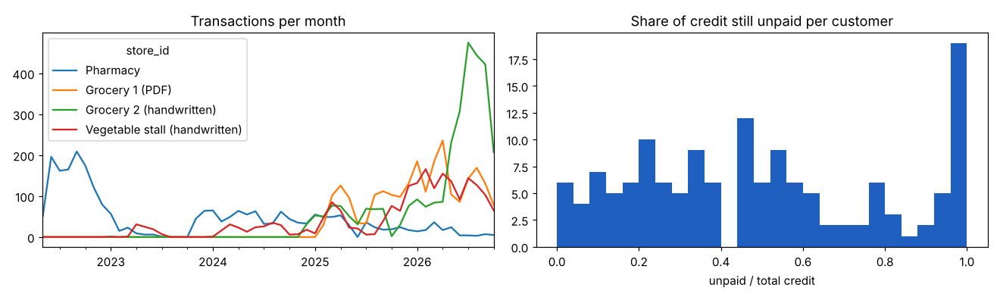
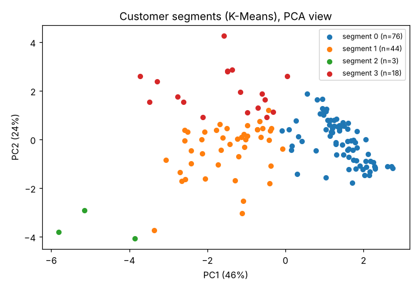
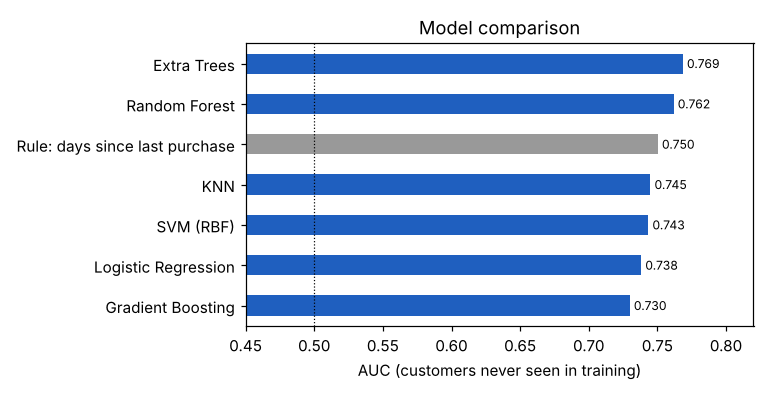
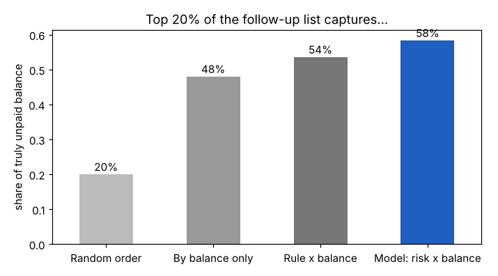
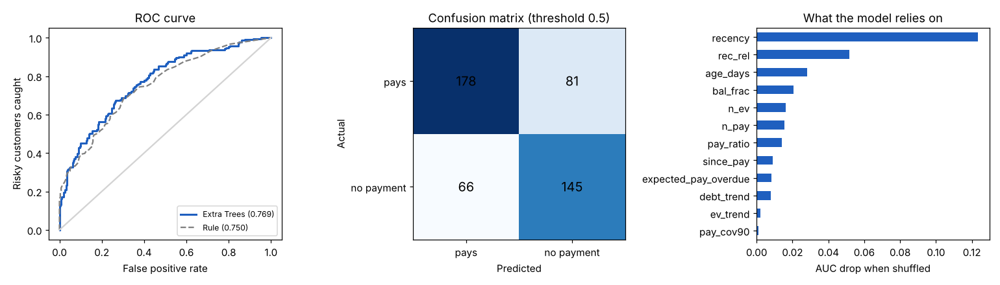

# Early Warning for Late and Unpaid Customer Credit

**[🇾🇪 اقرأ بالعربية](README.ar.md)** · [Methodology](docs/methodology.md) · [All experiments](docs/experiments.md) · [Data](data/README.md) · [Notebook](notebooks/early_warning_analysis.ipynb)

[](https://colab.research.google.com/github/alnsyryfwzy55-source/shop-credit-early-warning/blob/main/notebooks/early_warning_analysis.ipynb)
  
**[Try the live app](https://raw.githubusercontent.com/alnsyryfwzy55-source/shop-credit-early-warning/app/)** - upload a ledger and get the follow-up in your browser.

A machine-learning system that tells a merchant, early and in plain words, **which customers who owe money are drifting towards not paying** — and where to focus collection first. Built and validated on real credit ledgers collected by hand.

---

## 1. The idea

### The problem everyone in trade knows
Selling on credit is everywhere: wholesalers supplying retailers, retailers supplying households, pharmacies, building-material suppliers, workshops, distributors, service providers. The customer takes the goods today and promises to pay later. And almost every merchant lives with the same pain:

- **Late payment** — the customer keeps buying but pays less and less often.
- **Disappearing debtors** — the customer quietly stops coming, with a balance still open.
- **Cash-flow pressure** — money tied up in unpaid credit is money the merchant cannot use to restock, pay suppliers or grow.
- **No early warning** — banks have credit scoring; small and medium businesses usually have a notebook or a simple accounting app, and they find out too late.

### The approach
Every credit ledger, whatever the business, has the same core: **an amount against a date** — what was taken, what was paid, and when. The customer's *behaviour* over time is written in that ledger. This project learns that behaviour and turns it into an **early-warning list**:

1. For every customer who currently owes money, estimate the **probability of no payment at all in the next 180 days**.
2. Multiply it by the open balance → **expected loss**.
3. Rank the follow-up list by expected loss, give a **plain-language reason** for each alert (e.g. *"hasn't bought for 54 days, used to come almost daily; last payment 71 days ago, usually pays every 17 days"*), and suggest an action.
4. Group customers into **behaviour segments** to understand the customer base.
5. Monitor every month whether predictions came true, and retrain when needed.

The system **never refuses anyone automatically**: it informs, the merchant decides.

---

## 2. Data sources and sample

To build and test the idea we needed real ledgers. We collected them in the field from **four shops of different kinds**, which serve as the sample for this study (the same approach applies to any business that sells on credit):

| Shop | Type | Customers | Entries | Period | Source |
|---|---|---|---|---|---|
| S1 | Pharmacy | 83 | 2,460 | 2022-05 → 2026-10 | PDF statements from an accounting app |
| S2 | Grocery 1 | 29 | 2,395 | 2025-02 → 2026-10 | PDF statements |
| S3 | Grocery 2 | 8 | 3,105 | 2024-12 → 2026-10 | **Handwritten notebook**, digitised by hand |
| S4 | Vegetable store | 24 | 2,120 | 2023-01 → 2026-10 | **Handwritten notebook**, digitised by hand |
| **Total** | | **144** | **10,080** | | |

- Entry types: 9,407 credit purchases · 631 payments · 36 returns · 6 transfers.
- **Anonymised:** customer and shop names were removed and replaced by IDs. The anonymised data is published in [`data/shop_ledgers.csv`](data/shop_ledgers.csv) so that every number here can be reproduced.
- Cleaning steps and assumptions (inferred years in handwritten notebooks, impossible dates, returns vs payments) are documented in [docs/methodology.md](docs/methodology.md).



---

## 3. How it works

**Snapshots in time, no leakage.** Every 60 days, for each customer who owes money and still buys, 12 behavioural features are computed **only from the past**; the label looks **only at the future** (any payment in the next 180 days?). → 470 snapshots, 119 customers, 45% did not pay.

**Features** (no personal data, no shop identity): days since last purchase · absence compared with the customer's own rhythm · days since last payment · number of payments · share repaid · balance share · activity trend · credit trend · overdue vs usual payment interval · account age · …

**Unsupervised learning — K-Means + PCA:** reveals customer segments without any labels: regular payers (≈80% repaid), active customers with growing debt, customers who left long ago with most of their debt unpaid, and a few very heavy buyers.



**Supervised learning — 12 algorithms compared**, validated so that a customer is never in both training and test. Extra Trees performed best.



---

## 4. Results

| Check | Result |
|---|---|
| Customer-grouped cross-validation | **AUC 0.769** (95% CI 0.72–0.82) |
| 28 customers held out from the start, tested once | AUC 0.70 |
| Later period (train before Jul 2025, test after) | AUC 0.715 vs 0.672 for a simple rule |
| A shop of similar type the model never saw / a very different type | AUC 0.74–0.77 / 0.63 |
| Shuffled labels (leakage check, must be ≈ 0.5) | 0.51 |
| Probability quality (Brier) | 0.196 vs 0.247 baseline |

**Practical value:** the **top 20% of the follow-up list holds 58% of the credit that was really never repaid** — versus 48% when ranking by balance alone and 20% at random.



**Reality check:** shop owners rated 34 of their customers (committed / late / fled). Without ever seeing those ratings, the model's ranking agreed with them (AUC 0.67–0.75). Backtest: a model trained on data up to March 2026 put 35 active customers in levels; six months later, 8% of the "low" level and 70% of the "medium" level had not paid.



### What we learned
- **The strongest signal is absence, not the size of the debt.** A customer who stops coming stops paying — exactly what experienced merchants say.
- **More data from elsewhere did not help.** We tested 7 external datasets (Kaggle credit data, 50k B2B invoices, a Nigerian lender, the Kenya Financial Diaries…), synthetic data, 12 algorithms, tuning, voting and stacking. None improved accuracy on real customers, and the "best" of 480 configurations dropped sharply on held-out customers. Details: [docs/experiments.md](docs/experiments.md).
- **What will raise accuracy** is more information about the customers themselves: more shops and customers (each doubling ≈ +0.02 AUC), and recording at credit time a guarantor, how the merchant knows the customer, the income cycle, an agreed limit, and refused requests.

---

## 5. Run it

**In the browser:** click **Open in Colab** above → *Runtime → Run all*. The notebook loads the published data automatically.

**Locally:**
```bash
pip install -r requirements.txt
python src/credit_system/train.py   data/shop_ledgers.csv --out models                 # train + validate + thresholds
python src/credit_system/score.py   data/shop_ledgers.csv --models models --out follow_up.csv --log logs   # weekly list
python src/credit_system/monitor.py data/shop_ledgers.csv --models models --log logs  # monthly health check
```
To use your own business ledger, export it with the columns described in [data/README.md](data/README.md).

**The follow-up list** (`follow_up.csv`) contains, for every customer: priority, level (high / medium / low / left with debt), probability of no payment, balance, expected loss, a churn alert, the reasons and the suggested action.

## 6. Repository structure
```
├── README.md · README.ar.md
├── data/
│   ├── shop_ledgers.csv        anonymised real ledgers (10,080 entries)
│   └── README.md               columns, cleaning, anonymisation
├── notebooks/
│   └── early_warning_analysis.ipynb   full analysis with outputs (Colab-ready)
├── src/credit_system/
│   ├── features.py   features from the past only
│   ├── train.py      training, validation, money-based thresholds
│   ├── score.py      follow-up list with reasons and actions
│   └── monitor.py    outcome check, drift, retrain alert
├── docs/
│   ├── methodology.md · experiments.md
│   └── figures/
├── requirements.txt · LICENSE
```

## 7. Limitations and responsible use
119 modelled customers in 4 shops; it cannot judge a brand-new customer on the first request; it is weaker on a type of business it has not seen, so a new business should be monitored for three months and then retrained. It is a decision-support tool: **no automatic refusals**, and decisions should be logged so the data does not become biased towards customers who were granted credit.


## Author
**Fawzi AL-Nusairi — فوزي النصيري**
Final project of a machine-learning course (supervised and unsupervised learning).
Thanks to the shop owners who opened their ledgers for this work.

License: [MIT](LICENSE)
